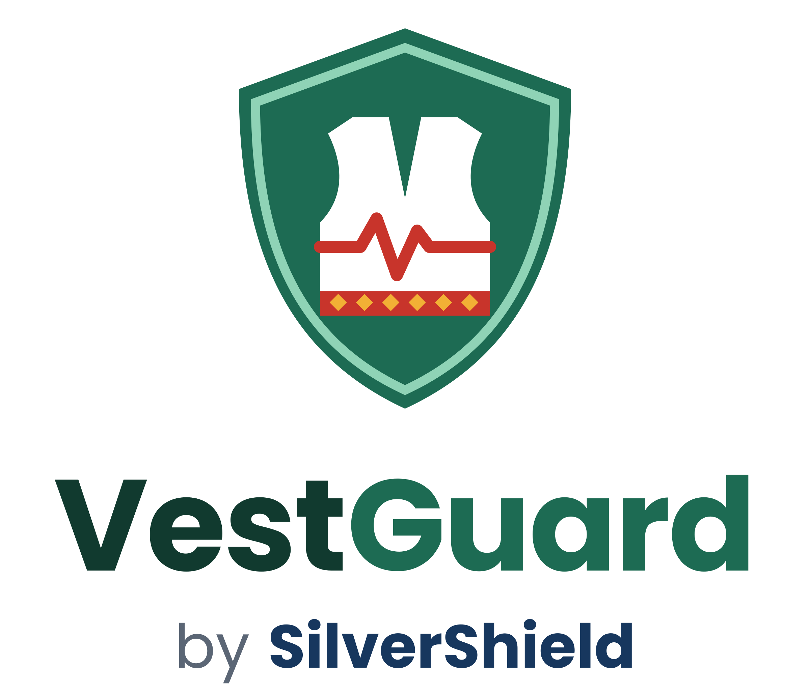
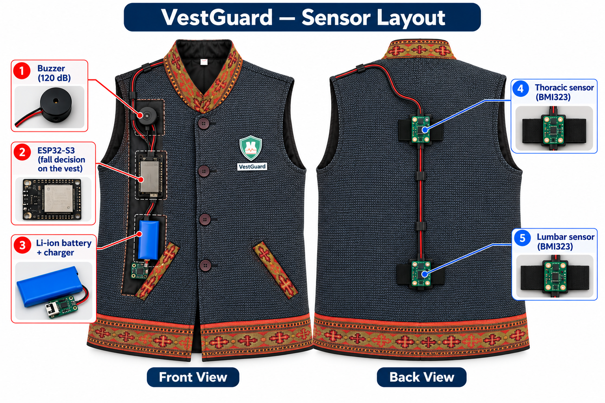
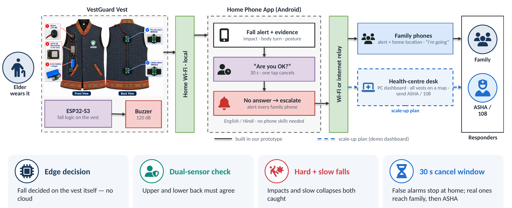
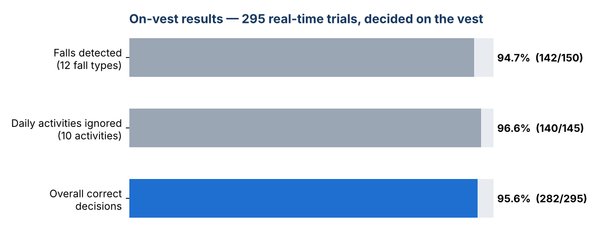
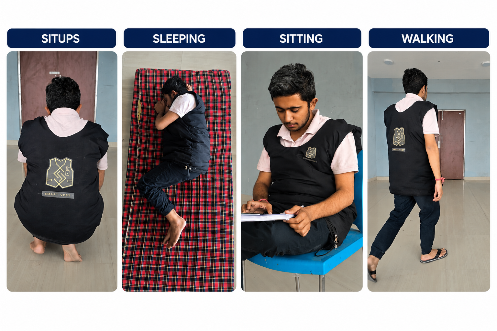
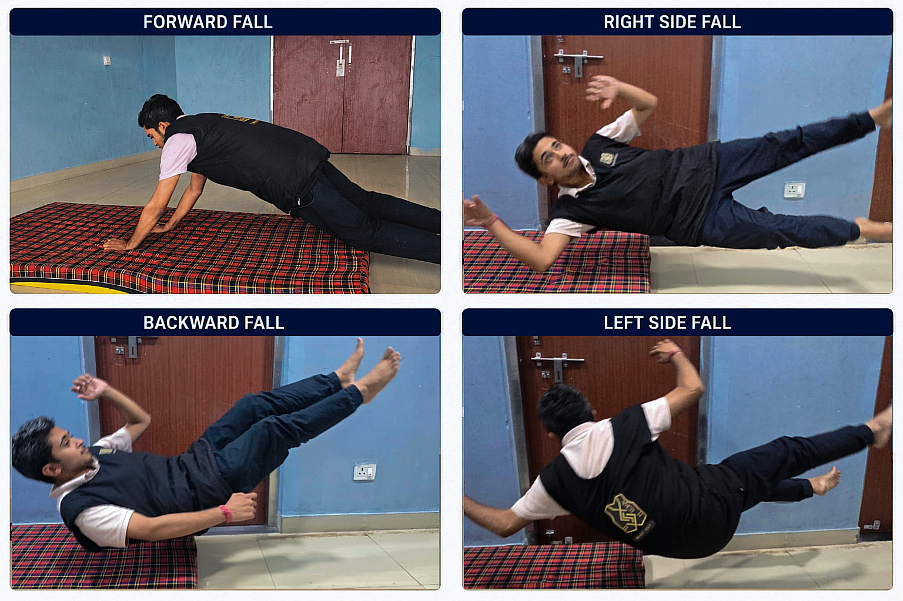
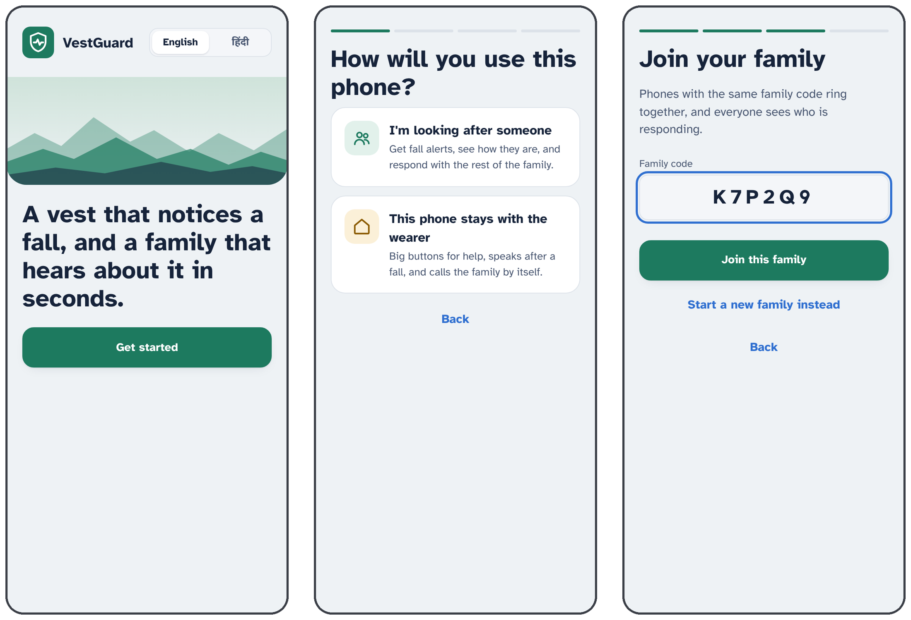
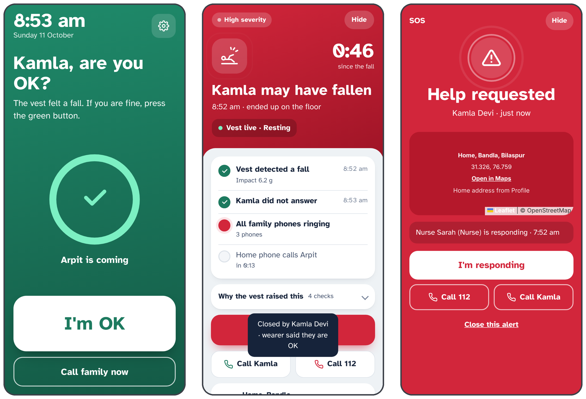

<div align="center">



# VestGuard

### A smart vest that detects falls on its own and calls for help — built for elders living alone in the Himalayan hills


-17375E)


</div>

---

## Why

About **one in three** older adults falls every year. The fall is often not the worst part — the **wait** is. An elder who lives alone, hurt or confused on the floor, may not be found for hours. In hill villages, where houses are far apart and children work in the cities, that wait is longer.

Panic buttons need the person to press them. Smartwatches sit on the wrist, which moves all day, and miss slow collapses.

## The vest

<div align="center"></div>
<div align="center"><sub>VestGuard V2 — a Himachali-style vest with the electronics hidden inside. Two motion sensors sit on the spine.</sub></div>

## What VestGuard does

VestGuard is a familiar sleeveless vest with **two motion sensors on the spine**. The vest decides **on board, in real time**, whether a fall has happened — no button, no cloud — and then raises the alarm in layers:

1. **Fall detected on the vest** — sudden falls *and* slow collapses (fainting, sliding down a wall)
2. **120 dB buzzer** sounds at once — works with no network at all
3. **"Are you OK?"** on the home phone — 30 seconds to cancel a false alarm
4. **Every family phone rings** with the location; the phone then calls the first contact
5. **Health-centre desk** — at scale, alerts reach the nearest PHC and its ASHA workers

<div align="center"></div>

## Results

295 real-time trials with the V2 prototype — every decision made **by the vest itself**:

<div align="center"></div>

| Test set | Trials | Correct | Rate |
|---|---|---|---|
| Falls detected (12 fall types) | 150 | 142 | **94.7%** |
| Daily activities correctly ignored (10 activities) | 145 | 140 | **96.6%** |
| **Overall** | **295** | **282** | **95.6%** |

A separate offline machine-learning study (CatBoost / gradient boosting, validated with GroupKFold by trial) reached **95.3% accuracy, AUC 0.984**. Details: [docs/TESTING.md](docs/TESTING.md).

## Hardware

| Part | Role |
|---|---|
| ESP32-S3 | Reads both sensors at 50 Hz, runs the detection engine, drives the buzzer, Wi-Fi link |
| 2 × Bosch BMI323 (6-axis IMU) | Upper back (thoracic) and lower back (lumbar) |
| 120 dB buzzer | Local alarm that needs no network |
| Li-ion battery | All-day wear, charged at night |
| Himachali-style vest | Something elders already wear every day |

Prototype bill of materials: **₹4,204** — about **₹3,000** at volume. More in [docs/HARDWARE.md](docs/HARDWARE.md).

## Testing

Every trial was done by young volunteers, with falls only onto safety mats.

<div align="center">

<br/><sub>Daily activities — the vest must stay quiet</sub>
<br/><br/>

<br/><sub>Falls — forward, backward and to each side, onto mats</sub>
</div>

## Demo

<div align="center">

<br/><sub>Scan to watch VestGuard working</sub>
</div>

## App and health-centre desk

<div align="center">

<br/><sub>Setup — choose how the phone is used, join the family with a code</sub>
<br/><br/>

<br/><sub>During a fall — the elder's home phone, a family phone, a health worker responding</sub>
</div>

- **Android app** (Capacitor + native Java): full-screen alarm, "Are you OK?" countdown, family alerts with map, "I'm going" coordination, English and Hindi.
- **Health-centre desk** (this repo, [`health-desk/`](health-desk/)): a browser dashboard for a PHC showing households, live alerts, and help-on-the-way routes. Runs on any PC with Python 3 standard library only.

## Tech stack

| Layer | Technology |
|---|---|
| Firmware | C++ (Arduino framework, ESP32 core), I²C, Wi-Fi/UDP |
| Mobile app | Capacitor (HTML/CSS/JS) + native Android (Java), Leaflet + OpenStreetMap |
| Internet relay | ntfy push topics, one per family |
| Health desk | Python 3 (stdlib) + HTML/JS dashboard, Leaflet |
| Data and ML | Python, pandas, NumPy, scikit-learn, CatBoost, Jupyter |

## What's in this repository

```
firmware/sensor-daq/   ESP32-S3 firmware: dual-BMI323 driver + 50 Hz UDP streaming (data collection)
health-desk/           PHC dashboard (phc.html) + Python bridge server (phc_server.py)
docs/                  Architecture, hardware, testing protocol and results, roadmap
images/                Figures and app screenshots
```

### What is not published

The fall-detection method, the vest's production firmware, the Android app source, the test data and the trained models are **not** in this repository. They are part of a patent application and stay private until the patent process is complete. Happy to walk through the work in an interview or under NDA.

## Patent

| | |
|---|---|
| **Status** | Patent pending (provisional application filed) |
| **Application No.** | 202611122870 |
| **Filed** | October 2026, Indian Patent Office |
| **Title** | *Smart Garment for Automatic Fall Detection using Dual Trunk Inertial Sensors and Method Thereof* |

## Recognition

- 🥇 **1st Prize — State Level Smart Hackathon 2026**, Himachal Pradesh (department, college and state rounds)
- Invited to apply to the **Himachal Pradesh State Innovation Fund** to take VestGuard from prototype to pilot

## Roadmap

4G (LTE Cat-1) SMS and calls from the vest itself · detachable, washable electronics strip · extra sensing to cut false alarms · supervised pilot with a primary health centre. See [docs/ROADMAP.md](docs/ROADMAP.md).

## Team SilverShield

| Member | Role | GitHub |
|---|---|---|
| **Arpit Awasthi** (team lead) | Firmware and detection, app, system design, patent | [@ArpitAwasthi2411](https://github.com/ArpitAwasthi2411) |
| **Yogit** | Hardware, vest building and testing | |
| **Shagun Sharma** | Health partnerships and documentation | [@ShagunSharma-rk](https://github.com/ShagunSharma-rk) |
| **Rashi** | Components, sourcing and budget | [@rashiguleria](https://github.com/rashiguleria) |
| **Neelaksh Thakur** | Early prototype development and testing | [@neelakshthakur566-art](https://github.com/neelakshthakur566-art) |

Mentor: **Dr. Ravi Kumar**

---

<sub>© 2026 Team SilverShield. All rights reserved. This repository is shared for demonstration only; no licence is granted to use, copy or modify the code or designs. See [LICENSE](LICENSE).</sub>
